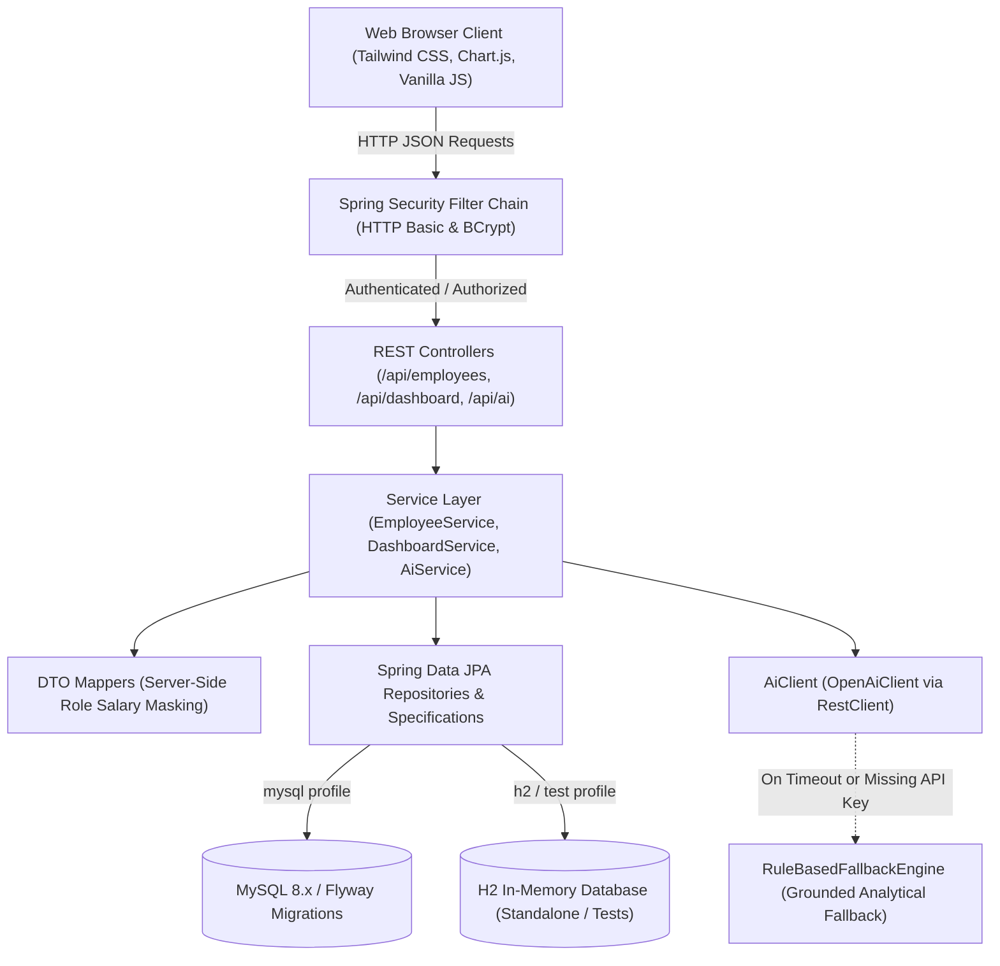
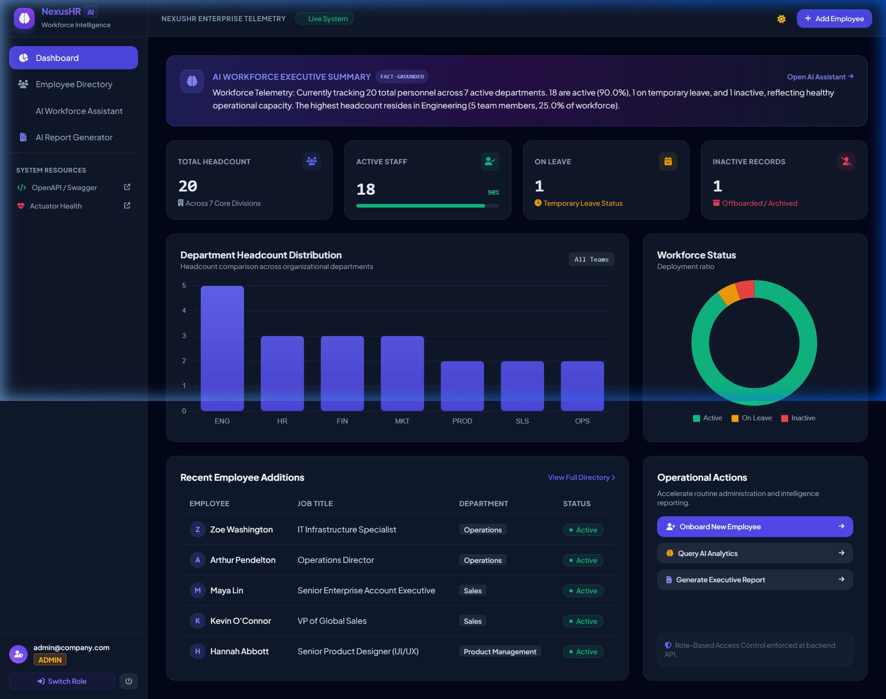
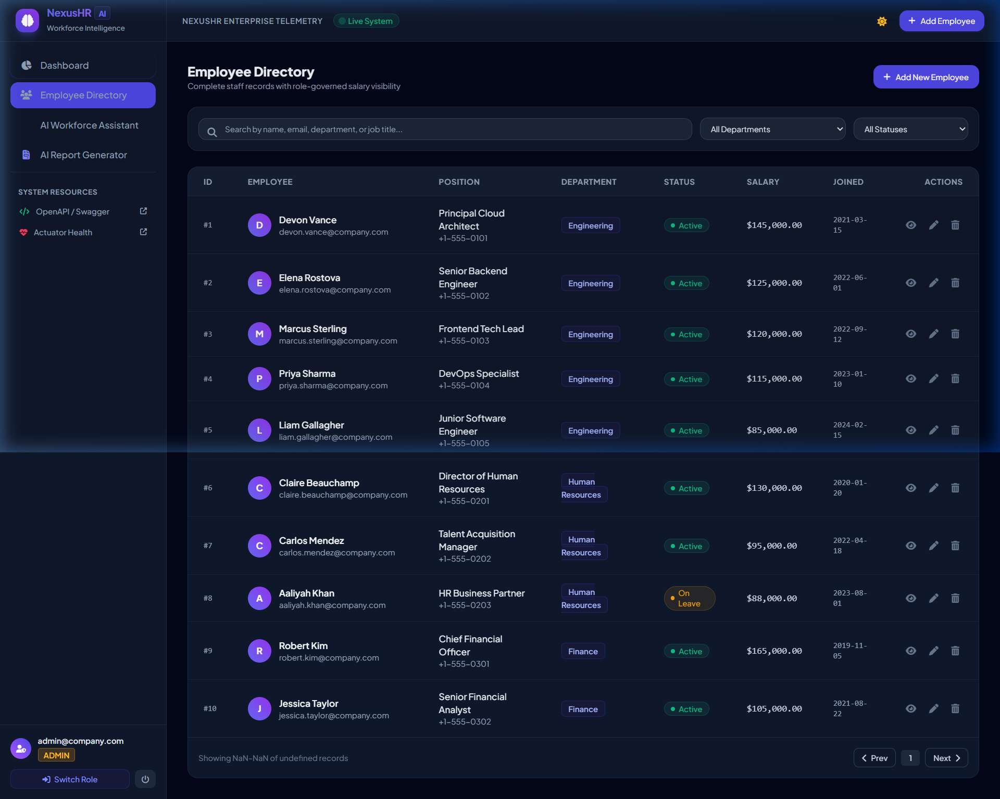
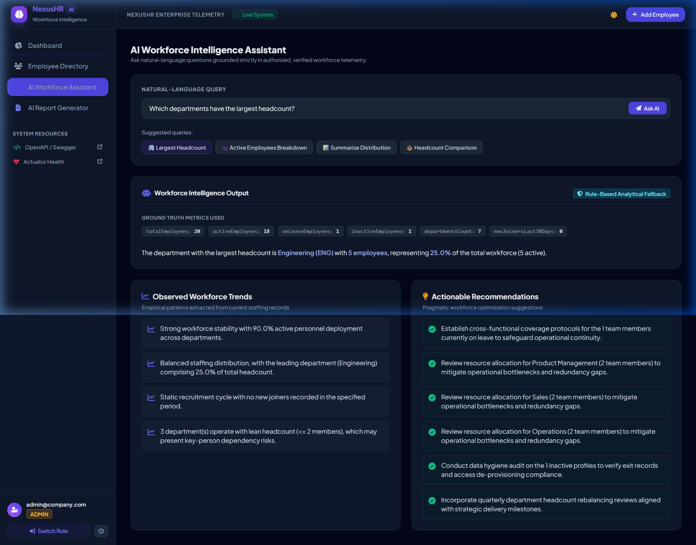
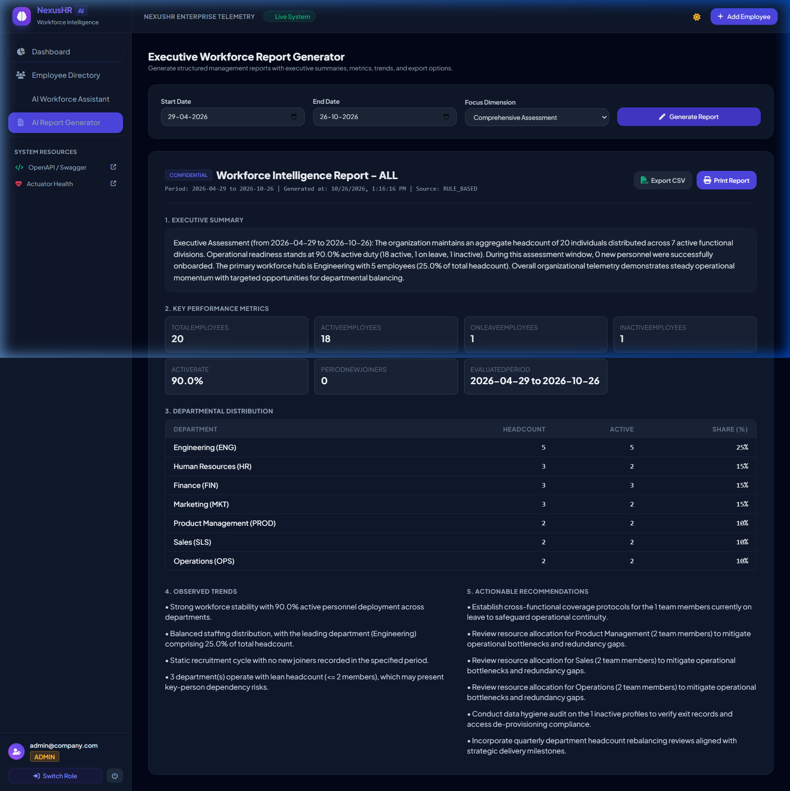

# NexusHR - AI-Powered Employee Management System

[](https://adoptium.net/)
[](https://spring.io/projects/spring-boot)
[](https://spring.io/projects/spring-security)
[](https://www.mysql.com/)
[](LICENSE)

A production-style, full-stack **AI-Powered Employee Management System** engineered with **Java 21**, **Spring Boot 3.3.5**, **Spring Security**, **Spring Data JPA**, **Hibernate**, **MySQL 8.x**, **Flyway**, **Vanilla JavaScript**, and **Tailwind CSS**.

NexusHR delivers secure employee lifecycle management, role-based access control (RBAC), an interactive dashboard with Chart.js telemetry, and fact-grounded workforce intelligence powered by Large Language Models (LLMs) with an intelligent, deterministic rule-based fallback engine.

---

## Table of Contents

- [Key Features](#key-features)
- [Technology Stack](#technology-stack)
- [System Architecture](#system-architecture)
- [Screenshots](#screenshots)
- [Project Directory Structure](#project-directory-structure)
- [Prerequisites](#prerequisites)
- [Environment Variables Configuration](#environment-variables-configuration)
- [Local Setup & Running](#local-setup--running)
  - [Option 1: Quick-Start Standalone Mode (H2 In-Memory)](#option-1-quick-start-standalone-mode-h2-in-memory)
  - [Option 2: Running with Local MySQL 8.x](#option-2-running-with-local-mysql-8x)
  - [Option 3: Running with Docker Compose](#option-3-running-with-docker-compose)
- [Development Test Accounts](#development-test-accounts)
- [REST API Endpoint Reference](#rest-api-endpoint-reference)
- [cURL Request & Response Examples](#curl-request--response-examples)
- [AI Integration & Fallback Engine](#ai-integration--fallback-engine)
- [Automated Testing & Verified Coverage](#automated-testing--verified-coverage)
- [Troubleshooting Guide](#troubleshooting-guide)
- [Security Considerations](#security-considerations)
- [License](#license)

---

## Key Features

- **Role-Based Access Control (RBAC):**
  - **`ADMIN`**: Full CRUD permissions, compensation visibility, status lifecycle updates, employee deletion, and formal executive report generation.
  - **`USER`**: Read-only directory access with **server-side salary masking**, natural-language workforce queries, and department insights.
  - Server-side authorization enforced via `@PreAuthorize` annotations and Spring Security Filter Chain returning JSON `401 Unauthorized` and `403 Forbidden` responses.
- **Complete Employee Lifecycle CRUD:**
  - Automated ID generation and database-backed unique email enforcement with `409 Conflict` resolution.
  - Full employee metadata: full name, unique work email, department association, job title, phone number, joining date validation (`@PastOrPresent`), employment status (`ACTIVE`, `ON_LEAVE`, `INACTIVE`), and compensation (`BigDecimal`).
  - Search across employee names, job titles, departments, or emails; filtering by department and employment status; server-side pagination and sorting.
- **AI-Powered Workforce Intelligence:**
  - **Natural-Language Analytics**: Ask queries in plain English (*"Which departments have the largest headcount?"*, *"How many active employees work in each department?"*).
  - **Fact-Grounded Prompting**: The backend only feeds verified mathematical aggregates to LLM prompts—never executes raw SQL and never exposes employee credentials or private records.
  - **Automatic Rule-Based Fallback Engine**: If no `AI_API_KEY` is configured or if the external provider times out or fails, the application switches automatically to an internal deterministic statistical engine.
  - **Executive Report Generator**: Generates formal management assessments with executive summaries, key performance metrics, department distributions, observed trends, and actionable recommendations.
  - **Export Capabilities**: Direct client-side **CSV export** and **print-optimized HTML stylesheet** (`window.print()`).
- **Interactive Responsive Dashboard:**
  - Real-time headcount metric cards (Total, Active with percentage progress bar, On Leave, Inactive / Terminated).
  - Interactive **Chart.js** department headcount distribution bar chart and workforce status doughnut chart.
  - Recent employee additions table and operational quick action shortcuts.
  - Sleek enterprise dark and light mode toggle with state persistence in `localStorage`.
- **Database Architecture & Migrations:**
  - Relational schema with foreign keys, constraints, and composite search indexes.
  - Automated database versioning via **Flyway** migrations (`V1__init_schema.sql`, `V2__seed_data.sql`).

---

## Technology Stack

| Layer | Component | Version / Specification |
|---|---|---|
| **Runtime Environment** | Java Platform | Java 21 LTS (compiles and runs on Java 21+) |
| **Backend Framework** | Spring Boot | 3.3.5 |
| **Security Framework** | Spring Security | 6.3.x (HTTP Basic, BCrypt, Method Security) |
| **Data Persistence** | Spring Data JPA / Hibernate | 6.5.x |
| **Database Migrations** | Flyway | 10.x (`flyway-core`, `flyway-mysql`) |
| **Production Database** | MySQL | 8.x (`com.mysql:mysql-connector-j`) |
| **Testing / Standalone DB** | H2 Database | 2.2.x (MySQL compatibility mode) |
| **API Documentation** | Springdoc OpenAPI | 2.6.0 (Swagger UI at `/swagger-ui.html`) |
| **Monitoring** | Spring Boot Actuator | Health, Info, Metrics (`/actuator/health`) |
| **Frontend Technologies** | HTML5, CSS3, Vanilla JavaScript | Native Fetch API, Hash Routing, DOM State Management |
| **CSS & Design System** | Tailwind CSS CDN | Plus Jakarta Sans, JetBrains Mono, Dark Mode |
| **Visualizations & Icons** | Chart.js 4.4.x & FontAwesome 6 | Responsive Bar & Doughnut charts |
| **Containerization** | Docker & Docker Compose | Multi-stage Alpine container build |

---

## System Architecture



---

## Screenshots

The following screenshots illustrate the actual running application:

### 1. Enterprise Dashboard
Metrics cards, live telemetry banner, Chart.js department distribution, status doughnut chart, and recent hires:


### 2. Employee Directory & Filtering
Search, department filters, status pills, role-governed salary displays, and pagination:


### 3. AI Workforce Intelligence Assistant
Natural-language question answering, verified telemetry fact chips, rule-based fallback badge, and recommendations:


### 4. Executive Management Report Preview
Structured report generator with date range filters, metrics grid, department tables, trends, and CSV/Print export:


---

## Project Directory Structure

```
employee_management_system/
├── .env.example                               # Environment variable reference template
├── .gitignore                                 # Git ignore rules
├── Dockerfile                                 # Multi-stage production container definition
├── docker-compose.yml                         # Application and MySQL 8 service orchestrator
├── LICENSE                                    # Apache License 2.0
├── mvnw & mvnw.cmd                            # Portable Maven wrapper scripts
├── pom.xml                                    # Maven dependencies and build configuration
├── README.md                                  # Repository documentation
├── docs/
│   └── screenshots/                           # Verified application interface captures
│       ├── ai-assistant.png
│       ├── dashboard.png
│       ├── employee-directory.png
│       └── executive-report.png
└── src/
    ├── main/
    │   ├── java/com/example/employeemanagement/
    │   │   ├── EmployeeManagementApplication.java  # Main application entry point
    │   │   ├── ai/                            # LLM client & Rule-based fallback engine
    │   │   ├── config/                        # OpenAPI & Spring Data web config
    │   │   ├── controller/                    # REST API controllers
    │   │   ├── dto/                           # Request/Response DTOs & Validation
    │   │   ├── entity/                        # JPA Entities (Employee, Department, User, Role)
    │   │   ├── exception/                     # Centralized exception handling (@RestControllerAdvice)
    │   │   ├── mapper/                        # Entity-DTO mappers with salary masking
    │   │   ├── repository/                    # Spring Data JPA repositories
    │   │   ├── security/                      # UserDetails, SecurityConfig, DataInitializer
    │   │   └── service/                       # Business service interfaces and implementations
    │   └── resources/
    │       ├── application.yml                # Main application configuration
    │       ├── application-mysql.yml          # MySQL datasource & Flyway settings
    │       ├── application-h2.yml             # Standalone & test profile configuration
    │       ├── db/migration/                  # Flyway database migration scripts
    │       │   ├── V1__init_schema.sql
    │       │   └── V2__seed_data.sql
    │       └── static/                        # Frontend Single Page Application
    │           ├── index.html
    │           ├── css/styles.css
    │           └── js/
    │               ├── api.js                 # Centralized API fetch wrapper
    │               └── app.js                 # State management & Chart.js logic
    └── test/java/com/example/employeemanagement/
        ├── ai/AiServiceTest.java              # AI client and fallback unit tests
        ├── controller/EmployeeControllerSecurityIntegrationTest.java # MockMvc security tests
        └── service/
            ├── DashboardServiceTest.java      # Dashboard telemetry unit tests
            └── EmployeeServiceTest.java       # Employee CRUD and validation unit tests
```

---

## Prerequisites

Before running the application, ensure the following tools are available on your system:

- **Java Development Kit (JDK)**: Java 21 LTS installed and set on your `PATH`.
- **Apache Maven**: Version 3.8+ (or use the included portable `./mvnw` / `mvnw.cmd` scripts).
- **MySQL 8.x** (Optional): Required when running with the `mysql` profile. Not required when using the `h2` standalone profile or Docker Compose.
- **Docker & Docker Compose** (Optional): For running containerized deployments.

Verify your local Java version:
```bash
java -version
```

---

## Environment Variables Configuration

The application reads configuration through system environment variables or standard properties.

> **Note on `.env` files:** Spring Boot does not automatically load unexported `.env` files into its application context. When using Docker Compose, variables from `.env` are automatically injected into the container. For local terminal execution, export the variables in your shell or pass them as standard `-D` arguments.

Copy `.env.example` to create your local `.env`:
```bash
cp .env.example .env
```

### Supported Environment Variables:

| Variable Name | Default Value | Description |
|---|---|---|
| `SERVER_PORT` | `8080` | HTTP port for the web server |
| `SPRING_PROFILES_ACTIVE` | `mysql` | Active profile: `mysql` or `h2` |
| `SPRING_DATASOURCE_URL` | `jdbc:mysql://localhost:3306/employee_db?...` | JDBC connection URL for MySQL |
| `SPRING_DATASOURCE_USERNAME` | `root` | Database username |
| `SPRING_DATASOURCE_PASSWORD` | `rootpassword` | Database password |
| `APP_SECURITY_ADMIN_USERNAME` | `admin@company.com` | Default admin email |
| `APP_SECURITY_ADMIN_PASSWORD` | `Admin@123` | Default admin password |
| `APP_SECURITY_USER_USERNAME` | `user@company.com` | Default staff user email |
| `APP_SECURITY_USER_PASSWORD` | `User@123` | Default staff user password |
| `AI_PROVIDER` | `openai` | AI Provider: `openai`, `gemini`, `ollama` |
| `AI_API_KEY` | *(empty)* | API key for LLM provider (triggers fallback if omitted) |
| `AI_MODEL` | `gpt-4o-mini` | AI model identifier |
| `AI_BASE_URL` | `https://api.openai.com/v1` | Base endpoint for the AI provider |
| `AI_TIMEOUT_SECONDS` | `15` | Connect and read timeout for LLM calls |

---

## Local Setup & Running

### Option 1: Quick-Start Standalone Mode (H2 In-Memory)

Test the complete system immediately without installing or running a local MySQL server. Flyway schema and seed data are initialized automatically:

```bash
# Windows PowerShell
.\mvnw.cmd spring-boot:run "-Dspring-boot.run.profiles=h2"

# Linux / macOS
./mvnw spring-boot:run -Dspring-boot.run.profiles=h2
```

Or build and run the packaged JAR directly:
```bash
# Build package
.\mvnw.cmd clean package -DskipTests

# Run JAR with H2 profile
java -jar target/employee-management-system-1.0.0.jar --spring.profiles.active=h2
```

Access the application in your browser:
- **Application Dashboard:** [http://localhost:8080](http://localhost:8080)
- **Interactive Swagger UI:** [http://localhost:8080/swagger-ui.html](http://localhost:8080/swagger-ui.html)
- **Actuator Health Endpoint:** [http://localhost:8080/actuator/health](http://localhost:8080/actuator/health)
- **H2 Web Console:** [http://localhost:8080/h2-console](http://localhost:8080/h2-console) (JDBC URL: `jdbc:h2:mem:employeedb`, User: `sa`, Password: empty)

---

### Option 2: Running with Local MySQL 8.x

1. **Create the MySQL Database:**
   ```sql
   CREATE DATABASE IF NOT EXISTS employee_db CHARACTER SET utf8mb4 COLLATE utf8mb4_unicode_ci;
   ```

2. **Configure Connection Properties:**
   Set the credentials in your environment or update `application-mysql.yml`:
   ```bash
   # Windows PowerShell
   $env:SPRING_DATASOURCE_URL="jdbc:mysql://localhost:3306/employee_db?useSSL=false&serverTimezone=UTC&allowPublicKeyRetrieval=true"
   $env:SPRING_DATASOURCE_USERNAME="root"
   $env:SPRING_DATASOURCE_PASSWORD="your_mysql_password"
   $env:SPRING_PROFILES_ACTIVE="mysql"

   # Linux / macOS
   export SPRING_DATASOURCE_URL="jdbc:mysql://localhost:3306/employee_db?useSSL=false&serverTimezone=UTC&allowPublicKeyRetrieval=true"
   export SPRING_DATASOURCE_USERNAME="root"
   export SPRING_DATASOURCE_PASSWORD="your_mysql_password"
   export SPRING_PROFILES_ACTIVE="mysql"
   ```

3. **Start the Application:**
   Flyway will automatically execute `V1__init_schema.sql` and `V2__seed_data.sql`:
   ```bash
   # Windows PowerShell
   .\mvnw.cmd spring-boot:run

   # Linux / macOS
   ./mvnw spring-boot:run
   ```

---

### Option 3: Running with Docker Compose

Deploy the complete multi-container stack (Spring Boot application + MySQL 8.0 with health checks and persistent volume):

1. **Start Services:**
   ```bash
   docker-compose up --build -d
   ```

2. **Verify Service Health:**
   ```bash
   docker-compose ps
   ```

3. **View Application Logs:**
   ```bash
   docker-compose logs -f ems-app
   ```

4. **Tear Down:**
   ```bash
   docker-compose down
   ```

---

## Development Test Accounts

The system automatically initializes two development accounts at application startup:

| Account Type | Username / Email | Default Password | Permissions |
|---|---|---|---|
| **System Administrator** | `admin@company.com` | `Admin@123` | Full CRUD, Salary viewing, AI Report Generation, Employee Deletion |
| **Standard Staff User** | `user@company.com` | `User@123` | Read-only Directory, **Salary Masked**, Natural-Language Queries |

> **Security Advisory:** In production deployments, override `APP_SECURITY_ADMIN_PASSWORD` and `APP_SECURITY_USER_PASSWORD` using secure environment variables. Never deploy default passwords to production.

---

## REST API Endpoint Reference

NexusHR supports two verified authentication mechanisms:

1. **HTTP Basic Authentication (Stateless API Integration)**:
   - Provide the standard header `Authorization: Basic <base64(user:password)>` with every API request.
   - Recommended for CLI tools, cURL, OpenAPI Swagger UI, Postman, and automated test suites.
2. **Session-Based Authentication (Browser SPA & Cookies)**:
   - Call `POST /api/auth/login` with JSON payload `{"username": "...", "password": "..."}`.
   - On successful authentication, Spring Security establishes a servlet `HttpSession` and returns a `Set-Cookie: JSESSIONID=...` header.
   - Subsequent browser requests automatically transmit the session cookie.
   - Call `GET /api/auth/me` to inspect the active identity and granted roles.
   - Call `POST /api/auth/logout` to invalidate the active session and clear credentials.

### 1. Employee Endpoints

| HTTP Method | Path | Allowed Roles | Description |
|---|---|---|---|
| `GET` | `/api/employees` | `ADMIN`, `USER` | Get paginated employee records (supports `departmentId`, `status`, `query`, `page`, `size`, `sortBy`, `sortDir`) |
| `GET` | `/api/employees/{id}` | `ADMIN`, `USER` | Get employee by ID (Salary is masked for non-admin callers) |
| `POST` | `/api/employees` | `ADMIN` | Create new employee record (`201 Created` or `409 Conflict`) |
| `PUT` | `/api/employees/{id}` | `ADMIN` | Update complete employee record |
| `PATCH` | `/api/employees/{id}/status` | `ADMIN` | Update employee employment status (`ACTIVE`, `ON_LEAVE`, `INACTIVE`) |
| `DELETE` | `/api/employees/{id}` | `ADMIN` | Permanently remove employee record |
| `GET` | `/api/employees/search` | `ADMIN`, `USER` | Free-text search across name, department, title, or email |

### 2. Department & Dashboard Endpoints

| HTTP Method | Path | Allowed Roles | Description |
|---|---|---|---|
| `GET` | `/api/departments` | `ADMIN`, `USER` | List all departments with current headcount numbers |
| `GET` | `/api/departments/{id}` | `ADMIN`, `USER` | Get specific department by ID |
| `GET` | `/api/dashboard/summary` | `ADMIN`, `USER` | Returns headcount counts, active ratio, department distribution, and AI executive summary |

### 3. AI Workforce Intelligence Endpoints

| HTTP Method | Path | Allowed Roles | Description |
|---|---|---|---|
| `POST` | `/api/ai/query` | `ADMIN`, `USER` | Ask natural-language analytics questions using verified aggregate telemetry |
| `GET` | `/api/ai/insights` | `ADMIN`, `USER` | Retrieve calculated workforce trends and optimization recommendations |
| `POST` | `/api/ai/report` | `ADMIN` | Generate a structured executive workforce report |
| `GET` | `/api/ai/reports/history`| `ADMIN` | View the last 10 generated workforce reports from audit history |

### 4. Auth & System Endpoints

| HTTP Method | Path | Allowed Roles | Description |
|---|---|---|---|
| `GET` | `/api/auth/me` | Authenticated | Retrieve authenticated user principal and assigned roles |
| `POST` | `/api/auth/login` | Public | Verify credentials and establish session |
| `POST` | `/api/auth/logout` | Authenticated | Invalidate active user session |
| `GET` | `/actuator/health` | Public | Spring Boot Actuator application health check |
| `GET` | `/swagger-ui.html` | Public | Interactive OpenAPI Swagger UI documentation |

---

## cURL Request & Response Examples

### 1. View Employee Directory (Standard User - Salary Masked)
```bash
curl -s -u user@company.com:User@123 "http://localhost:8080/api/employees?page=0&size=2"
```

**Response (HTTP 200 OK):**
```json
{
  "success": true,
  "message": "Success",
  "data": {
    "content": [
      {
        "id": 1,
        "fullName": "Devon Vance",
        "email": "devon.vance@company.com",
        "departmentId": 1,
        "departmentName": "Engineering",
        "departmentCode": "ENG",
        "jobTitle": "Principal Cloud Architect",
        "phoneNumber": "+1-555-0101",
        "joiningDate": "2021-03-15",
        "employmentStatus": "ACTIVE",
        "salary": null
      }
    ],
    "page": {
      "size": 2,
      "number": 0,
      "totalElements": 20,
      "totalPages": 10
    }
  }
}
```

---

### 2. View Employee Details (Admin - Full Salary Visible)
```bash
curl -s -u admin@company.com:Admin@123 "http://localhost:8080/api/employees/1"
```

**Response (HTTP 200 OK):**
```json
{
  "success": true,
  "message": "Success",
  "data": {
    "id": 1,
    "fullName": "Devon Vance",
    "email": "devon.vance@company.com",
    "departmentId": 1,
    "departmentName": "Engineering",
    "departmentCode": "ENG",
    "jobTitle": "Principal Cloud Architect",
    "phoneNumber": "+1-555-0101",
    "joiningDate": "2021-03-15",
    "employmentStatus": "ACTIVE",
    "salary": 145000.00
  }
}
```

---

### 3. Create New Employee (Admin Only)
```bash
curl -s -u admin@company.com:Admin@123 -X POST "http://localhost:8080/api/employees" \
  -H "Content-Type: application/json" \
  -d '{
    "fullName": "Liam Gallagher",
    "email": "liam.gallagher.eng@company.com",
    "departmentId": 1,
    "jobTitle": "Platform Reliability Engineer",
    "phoneNumber": "+1-555-0199",
    "joiningDate": "2024-02-15",
    "employmentStatus": "ACTIVE",
    "salary": 118000.00
  }'
```

**Response (HTTP 201 Created):**
```json
{
  "success": true,
  "message": "Employee created successfully",
  "data": {
    "id": 21,
    "fullName": "Liam Gallagher",
    "email": "liam.gallagher.eng@company.com",
    "departmentName": "Engineering",
    "employmentStatus": "ACTIVE",
    "salary": 118000.00
  }
}
```

---

### 4. Role Enforcement Verification (Staff Attempting Delete)
```bash
curl -s -i -u user@company.com:User@123 -X DELETE "http://localhost:8080/api/employees/1"
```

**Response (HTTP 403 Forbidden):**
```json
{
  "status": 403,
  "error": "Forbidden",
  "message": "Access Denied: You do not have sufficient permissions to access this endpoint",
  "path": "/api/employees/1"
}
```

---

### 5. Natural-Language AI Analytics Query
```bash
curl -s -u user@company.com:User@123 -X POST "http://localhost:8080/api/ai/query" \
  -H "Content-Type: application/json" \
  -d '{"question":"Which departments have the largest headcount?"}'
```

**Response (HTTP 200 OK):**
```json
{
  "success": true,
  "data": {
    "question": "Which departments have the largest headcount?",
    "answer": "The department with the largest headcount is **Engineering (ENG)** with **5 employees**, representing **25.0%** of the total workforce (5 active).",
    "source": "RULE_BASED",
    "facts": {
      "totalEmployees": 20,
      "activeEmployees": 18,
      "onLeaveEmployees": 1,
      "inactiveEmployees": 1,
      "departmentsCount": 7
    }
  }
}
```

---

### 6. Session-Based Authentication Workflow (Login, Verify Session, Logout)

**Step A: Authenticate and Save Session Cookie**
```bash
curl -s -i -c cookies.txt -X POST "http://localhost:8080/api/auth/login" \
  -H "Content-Type: application/json" \
  -d '{"username":"admin@company.com","password":"Admin@123"}'
```

**Response (HTTP 200 OK with `Set-Cookie` header):**
```json
{
  "success": true,
  "message": "Login successful",
  "data": {
    "username": "admin@company.com",
    "name": "admin@company.com",
    "roles": ["ROLE_ADMIN"],
    "isAdmin": true,
    "message": "Authentication successful"
  }
}
```

**Step B: Access Protected Resource Using Saved Cookie**
```bash
curl -s -b cookies.txt "http://localhost:8080/api/auth/me"
```

**Response (HTTP 200 OK):**
```json
{
  "success": true,
  "data": {
    "username": "admin@company.com",
    "name": "admin@company.com",
    "roles": ["ROLE_ADMIN"],
    "isAdmin": true,
    "message": "User authenticated"
  }
}
```

**Step C: Invalidate Active Session (Logout)**
```bash
curl -s -b cookies.txt -X POST "http://localhost:8080/api/auth/logout"
```

**Response (HTTP 200 OK):**
```json
{
  "success": true,
  "message": "Logged out successfully",
  "data": "Session ended"
}
```

---

## AI Integration & Fallback Engine

NexusHR implements a resilient, multi-tiered AI architecture designed for enterprise safety, high availability, and data protection:

### 1. Controlled Grounded Context Prompting
The backend never executes unconstrained SQL queries and never sends private employee records or passwords to language models. Instead:
- JPA queries execute pre-defined mathematical aggregations (`COUNT`, group-by-department headcount, active/leave ratios, new joiner counts over 30/90 days).
- Grounded metrics are injected into a strict system prompt instruction: *"Answer using ONLY the provided verified metrics facts. Never fabricate metrics. Never generate SQL. Do not disclose personal employee credentials or passwords."*

### 2. Supported AI Providers & Endpoint Mapping
NexusHR connects to external AI providers via standard OpenAI-compatible REST endpoints (`POST /chat/completions`):

| Provider | `AI_BASE_URL` | `AI_MODEL` | Requirements |
|---|---|---|---|
| **OpenAI** (Default) | `https://api.openai.com/v1` | `gpt-4o-mini` | Set `AI_API_KEY=sk-...` |
| **Google Gemini** | `https://generativelanguage.googleapis.com/v1beta/openai/` | `gemini-1.5-flash` | Set Gemini API key in `AI_API_KEY` |
| **Ollama** (Local / Self-hosted) | `http://localhost:11434/v1` | `llama3` | Run `ollama run llama3`; set `AI_API_KEY=ollama` |
| **Azure OpenAI / vLLM / LocalAI** | `https://<resource>.openai.azure.com/openai/deployments/<model>` | `<deployment-name>` | Set endpoint and authentication key |

### 3. Missing-Key Detection & Automatic Bypassing
If `AI_API_KEY` is empty, omitted, or left as the default placeholder (`your-openai-api-key-here`), `AiClient.isConfigured()` evaluates to `false`. The backend completely skips outbound HTTP requests, preventing external network latency or authentication failures, and immediately serves responses from the internal rule engine.

### 4. Timeout Handling & Fault-Tolerant Fallback
Network requests to external AI APIs are wrapped in a `SimpleClientHttpRequestFactory` with connect and read timeouts configured by `AI_TIMEOUT_SECONDS` (default: `15` seconds).
- If the provider times out, returns HTTP 4xx/5xx, or experiences connection refusal, the exception is caught and logged at `WARN` level.
- The request is immediately and seamlessly handed off to `RuleBasedFallbackEngine`.
- The API response payload indicates the true generation origin (`source: "AI_LLM"` vs `source: "RULE_BASED"`).

### 5. Executive Report Generation & Audit Persistence
When an administrator generates an executive report (`POST /api/ai/report`):
- Date-bounded aggregation queries calculate active employee distribution, period joiners, and headcount dynamics.
- An executive summary is drafted (via LLM or deterministic engine).
- Key operational metrics, observed workforce trends, and prioritized recommendations are generated.
- The full report audit snapshot is persisted to the database table `ai_report_history` (`AiReportHistory` entity), allowing historic report retrieval via `GET /api/ai/reports/history`.

---

## Automated Testing & Verified Coverage

NexusHR includes a comprehensive automated test suite combining JUnit 5, Mockito, and Spring Boot Test with MockMvc.

To execute all tests:
```bash
# Windows PowerShell
.\mvnw.cmd test

# Linux / macOS
./mvnw test
```

### Verified Test Suite Breakdown:

| Test Class | Focus Area | Executed Tests | Status |
|---|---|---|---|
| `EmployeeServiceTest` | Employee CRUD, duplicate email rejection, status updates, deletion | 8 | Passed |
| `DashboardServiceTest` | Telemetry aggregations, active percentage rounding, quick summary logic | 1 | Passed |
| `AiServiceTest` | LLM communication, automatic fallback trigger on provider timeout, report history persistence | 4 | Passed |
| `EmployeeControllerSecurityIntegrationTest` | MockMvc integration: 401 unauthenticated, 403 user forbidden, 201 admin creation, 400 validation errors, 409 conflict | 9 | Passed |
| **Total** | **Full application test suite** | **22** | **100% Passed** |

---

## Troubleshooting Guide

### 1. Port 8080 Already in Use
If port 8080 is occupied by another process:
```bash
# Windows PowerShell
$env:SERVER_PORT="8081"
.\mvnw.cmd spring-boot:run
# Or pass arguments directly:
.\mvnw.cmd spring-boot:run "-Dspring-boot.run.arguments=--server.port=8081"

# Linux / macOS
export SERVER_PORT=8081
./mvnw spring-boot:run
# Or pass arguments directly:
./mvnw spring-boot:run -Dspring-boot.run.arguments="--server.port=8081"
```

### 2. MySQL Connection Refused
If you see `CommunicationsException: Communications link failure`:
- Ensure your MySQL server service is running (`net start MySQL80` on Windows, or `sudo systemctl start mysql` on Linux).
- Check that the database `employee_db` exists or that `createDatabaseIfNotExist=true` is enabled in the JDBC URL.
- Verify your password in `SPRING_DATASOURCE_PASSWORD`.
- Alternatively, run with the in-memory profile:
  ```bash
  # Windows PowerShell
  .\mvnw.cmd spring-boot:run "-Dspring-boot.run.profiles=h2"

  # Linux / macOS
  ./mvnw spring-boot:run -Dspring-boot.run.profiles=h2
  ```

### 3. PowerShell Character Escaping with cURL
On Windows PowerShell, `curl` is often aliased to `Invoke-WebRequest`, and quotes can be stripped. Use `curl.exe` with escaped quotes or `Invoke-RestMethod`:
```powershell
$headers = @{ Authorization = "Basic " + [Convert]::ToBase64String([Text.Encoding]::ASCII.GetBytes("admin@company.com:Admin@123")) }
Invoke-RestMethod -Uri "http://localhost:8080/api/dashboard/summary" -Headers $headers
```

---

## Security Considerations

- **Password Storage**: Passwords are never stored in plaintext. They are encrypted using Spring Security's `BCryptPasswordEncoder` with a strength factor of 10.
- **Server-Side Authorization**: Frontend buttons are hidden or disabled for non-admins for user experience only. The backend strictly validates user authorities via `@PreAuthorize("hasRole('ADMIN')")` on all modifying endpoints.
- **Salary Data Protection**: Compensation fields are completely omitted from the JSON payload when requested by standard users.
- **Container Hardening**: The Dockerfile uses a multi-stage build running an unprivileged user (`appuser:appgroup`) on an Alpine Linux base to prevent container escape vulnerabilities.
- **CORS Configuration**: Restricts allowed origins to localhost and same-origin domains by default. Permissive production wildcards (`*`) are disallowed.

---

## License

This project is licensed under the **Apache License 2.0**. See the [LICENSE](LICENSE) file for details.
